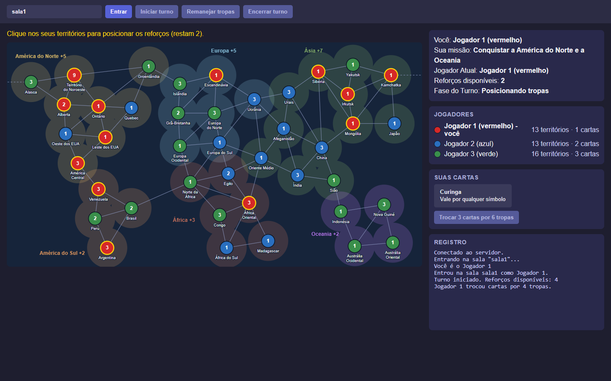

# War (Risk) em Python

[](https://github.com/KawanVictor/War/actions/workflows/ci.yml)



Implementação do jogo de tabuleiro War (inspirado em Risk), com:

- Motor de regras em Python (reforços, combate, cartas, turnos)
- Interface CLI interativa para jogar no terminal
- Servidor web em Flask usando Flask-SocketIO para partidas online em tempo real
- Estrutura modular para testes e fácil expansão

Dá para jogar partidas completas, do sorteio das missões à vitória. O que ainda falta está em [Limitações conhecidas](#limitações-conhecidas).

## Instalação

Testado com Python 3.12. Recomenda-se usar um ambiente virtual:

```bash
git clone https://github.com/KawanVictor/War.git
cd War
python -m venv .venv
```

Ative o ambiente:

```bash
# Windows (PowerShell)
.venv\Scripts\Activate.ps1

# Linux / macOS
source .venv/bin/activate
```

Instale as dependências:

```bash
pip install -r requirements.txt
```

## Como jogar

Execute os comandos abaixo na raiz do repositório.

### Versão web

```bash
python -m webapp.app
```

Abra `http://localhost:50001` no navegador. Cada aba ou navegador que entra na mesma sala ocupa um assento; a partida é de 3 jogadores, então abra três abas para jogar sozinho. Quem entra com a sala cheia assiste como espectador.

Cada jogador recebe uma missão secreta, mostrada no topo da página. Vence quem cumprir a própria missão ou for o último com territórios.

Em cada turno:

1. Clique em **Iniciar turno** quando for a sua vez.
2. Se quiser trocar cartas, selecione 3 no painel **Suas cartas** (mesmo símbolo ou três símbolos diferentes; o curinga vale por qualquer um) e clique em **Trocar**. As tropas da troca entram nos reforços do turno.
3. Clique nos seus territórios para posicionar os reforços, uma tropa por clique. É preciso posicionar todos antes de atacar ou encerrar.
4. Para atacar, clique em um território seu com pelo menos 2 tropas e depois em um vizinho inimigo destacado. A origem continua selecionada para atacar de novo; clique nela para soltar.
5. Para remanejar, clique em **Remanejar tropas**, escolha um território seu e clique em um vizinho seu: cada clique move 1 tropa. Depois de começar o remanejamento não dá mais para atacar, e cada tropa só se move uma vez por turno.
6. Clique em **Encerrar turno**.

O mapa mostra cada território como um círculo na cor do dono, com o número de tropas, ligado por linhas aos territórios vizinhos. Os seus têm contorno amarelo. A linha tracejada que sai pelas bordas liga o Alasca a Kamchatka.

A página carrega o cliente Socket.IO de um CDN, então o navegador precisa de acesso à internet. O servidor escuta em `0.0.0.0` e aceita conexões de qualquer origem, o que serve para testes em rede local, mas não para exposição pública.

### Versão terminal

```bash
python -m war_game.cli.main
```

Partida local de 3 jogadores no mesmo terminal, até alguém vencer. As escolhas são feitas por menus numerados. A missão e as cartas de cada jogador aparecem no início do turno dele. Use `Ctrl+C` para sair antes.

## Testes

```bash
pip install -r requirements-dev.txt
python -m pytest
```

Os testes do motor ficam em `war_game/tests/` e os do servidor web em `webapp/tests/`. O GitHub Actions roda a suíte a cada push e pull request, em Python 3.10, 3.12 e 3.13.

## Estrutura

```
├── war_game/
│   ├── models/      # Territory, Player, Card, Mission, GameState
│   ├── rules/       # combate, reforços, cartas, missões
│   ├── services/    # carregamento do mapa, criação da partida e gerenciador de turnos
│   ├── cli/         # jogo no terminal
│   ├── data/        # mapa, continentes, cartas e missões em JSON
│   └── tests/
├── webapp/
│   ├── app.py               # aplicação Flask e ponto de entrada
│   ├── socket_handlers.py   # eventos Socket.IO (join, start_turn, place, attack, end_turn)
│   ├── rooms.py             # salas e criação da partida
│   ├── state_adapter.py     # conversão do estado para JSON
│   ├── templates/           # página do jogo
│   ├── static/              # estilos e posições dos territórios no mapa
│   └── tests/
├── pyproject.toml
├── requirements.txt         # dependências com versão fixa
├── requirements-dev.txt     # dependências + pytest
└── README.md
```

## Regras implementadas

- Mapa com 42 territórios em 6 continentes, distribuídos aleatoriamente entre os jogadores
- Reforços: um a cada 3 territórios (mínimo 3), mais o bônus de continentes completos
- Combate com até 3 dados de ataque e 2 de defesa; empates favorecem a defesa
- Conquista de território e carta ao fim do turno para quem conquistou; o descarte é reembaralhado quando o baralho acaba
- Turno em fases validadas pelo motor: iniciar, posicionar todos os reforços, atacar, remanejar, encerrar
- Troca de cartas por tropas (4, 6, 8, 10, 12, 15 e depois de 5 em 5), com 2 tropas extras em um território próprio que apareça nas cartas
- Remanejamento entre territórios próprios vizinhos; cada tropa se move uma vez por turno e sempre fica pelo menos uma
- Missões secretas sorteadas no início: conquistar continentes, conquistar um número de territórios ou destruir uma cor
- Eliminação de jogadores (as cartas do eliminado vão para quem o eliminou) e fim de partida por missão cumprida ou último sobrevivente

## Limitações conhecidas

- A troca de cartas é sempre opcional; não há troca obrigatória com 5 cartas na mão
- O baralho tem só 11 cartas, em vez de uma por território
- O mapa da web é esquemático (círculos e fronteiras), sem o desenho dos países; os nomes seguem o tabuleiro do Risk traduzido, não o do War brasileiro
- Cada território começa com 1 tropa; não há a rodada inicial de distribuição de exércitos
- A partida web é sempre de 3 jogadores (o motor aceita de 2 a 6)
- Quem perde a conexão libera o assento; ao voltar, ocupa o primeiro assento livre, que pode não ser o mesmo

## Licença

Distribuído sob a licença MIT. Veja [LICENSE](LICENSE).
